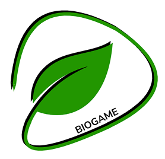

<p align="center"></p>

# BioGame

## Nome e descrição

**BioGame** é um jogo educativo para celular que conscientiza sobre o uso do plástico convencional e sobre as possibilidades dos bioplásticos. O jogador encontra uma árvore quase sem vida e a recupera respondendo perguntas; a jornada vai do **alerta vermelho** (o problema) até a **solução** (consumo consciente e alternativas bem escolhidas).

Projeto interdisciplinar desenvolvido em grupo.

## Objetivo e problema que busca solucionar

- **Problema:** o plástico convencional é produzido em larga escala, usado por poucos minutos e permanece no ambiente por séculos, e a população ainda conhece pouco os impactos e as alternativas, como os bioplásticos. A pergunta da pesquisa é: de que forma um jogo educativo para celular pode contribuir para a conscientização sobre o uso indevido do plástico convencional e sobre os bioplásticos?
- **Objetivo geral:** desenvolver um jogo educativo mobile que conscientize o jogador sobre o plástico convencional e apresente os bioplásticos como parte da solução.

## Público-alvo

Estudantes e jovens (ensino médio e superior) que usam celular e querem aprender sobre meio ambiente de forma leve, além de qualquer pessoa interessada em consumo consciente. Professores também podem usar o jogo como apoio em sala de aula.

## Principais funcionalidades

- Cadastro, login e recuperação de senha
- 4 níveis com 4 fases cada, narrativa e quiz por fase, mais um nível bônus
- Vidas em forma de folhas e explicação "Você sabia?" após cada acerto
- Árvore que evolui a cada nível e vira dourada ao fim do bônus
- Amigos (adicionados pelo e-mail) e ranking
- Conta, configurações e privacidade

## Tecnologias e ferramentas utilizadas

| Área | Ferramenta |
| --- | --- |
| App | React Native + Expo |
| Navegação | React Navigation (pilha e abas) |
| Login e dados | Firebase Authentication e Cloud Firestore |
| Landing page | HTML5 e CSS3 |
| Design | Figma |

## Instruções para instalação e execução

Requisitos: [Node.js](https://nodejs.org) 20+ e o app Expo Go (ou um emulador).

```bash
cd codigo-fonte/App-BioGame
npm install
npx expo start
```

Escaneie o QR Code com o Expo Go, ou pressione `a` (Android), `i` (iOS) ou `w` (navegador).
A configuração do Firebase fica em `codigo-fonte/App-BioGame/configuration/firebase.js`. As regras do Firestore estão em [docs/banco-de-dados.md](docs/banco-de-dados.md).

A landing page não precisa de instalação: abra `codigo-fonte/Landing-Page/index.html` no navegador.

## Estrutura do repositório

```
BioGame
├── README.md
├── LICENSE
├── .gitignore
├── docs/               requisitos, arquitetura, banco de dados, testes e manual do usuário
├── imagens/            logo, diagramas e telas (29 capturas nomeadas)
├── videos/             vídeos de demonstração
└── codigo-fonte/       App-BioGame e Landing-Page
```

## Documentação

- [Requisitos](docs/requisitos.md)
- [Arquitetura](docs/arquitetura.md)
- [Banco de dados](docs/banco-de-dados.md)
- [Testes](docs/testes.md)
- [Manual do usuário](docs/manual-usuario.md)

## Integrantes do grupo

- Aurora Santos Gonçalves
- Letícia Anti de Freitas Andrade
- Lorena Rodrigues Marinho
- Marina Yumi Shinomiya Brugnoli
- Maycon Ryan Fontinele de Araújo

## Licença

Distribuído sob a licença MIT. Veja o arquivo [LICENSE](LICENSE).
