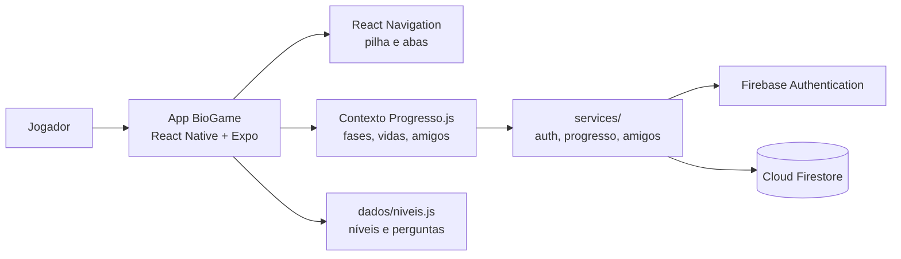

# Arquitetura

O app é uma aplicação React Native (Expo) com três camadas:

1. **Telas e componentes** (`Telas/`, `TelasLogin/`, `components/`): interface.
2. **Estado e navegação**: `Route.js` define a navegação (pilha principal e abas Início, Árvores, Ranking, Amigos e Mais); `Progresso.js` é um contexto React com fases concluídas, vidas e amigos.
3. **Serviços** (`services/`): acesso ao Firebase (`auth.js`, `progressoNuvem.js`, `amigosNuvem.js`).

O conteúdo educativo é independente do código de tela e fica em `dados/niveis.js`.

| Pasta/arquivo | Função |
| --- | --- |
| `App.js`, `Route.js` | Entrada e navegação |
| `Progresso.js` | Progresso, vidas e amigos |
| `dados/niveis.js` | Níveis, fases, narrativas e perguntas |
| `configuration/firebase.js` | Configuração do Firebase |
| `theme.js` | Cores, fontes e escala |
