# Manual do usuário

As telas abaixo são do protótipo do BioGame. Os arquivos estão em [`imagens/telas`](../imagens/telas).

## 1. Abertura, cadastro e login

Ao abrir o app, aparece a tela de abertura. Crie sua conta em **Cadastro** (e-mail, senha e confirmação da senha) ou entre em **Entrar** com e-mail e senha. Se esquecer a senha, toque em **Esqueceu a senha?**, informe o e-mail da conta e toque em **Enviar link**. Você recebe um e-mail do Firebase com o link para criar a nova senha.

| | | |
|---|---|---|
| 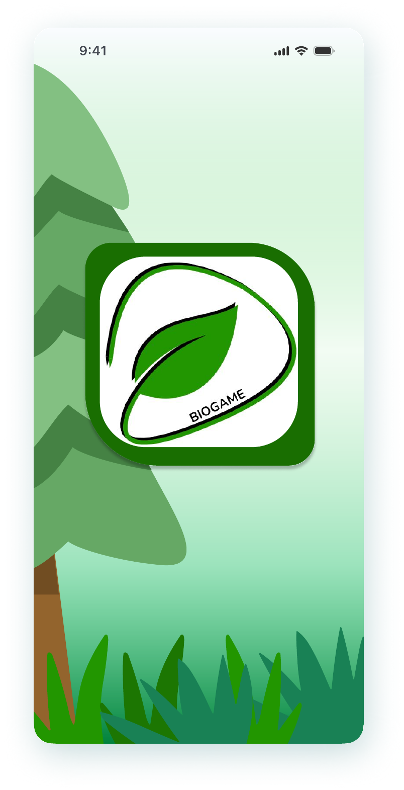 Abertura | 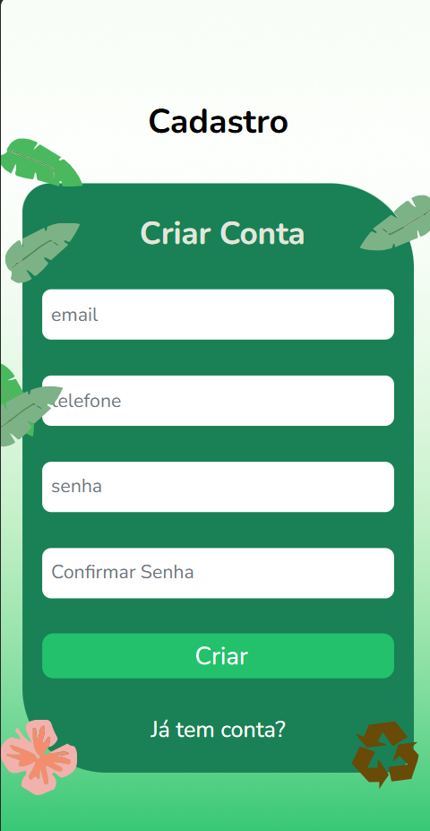 Cadastro | 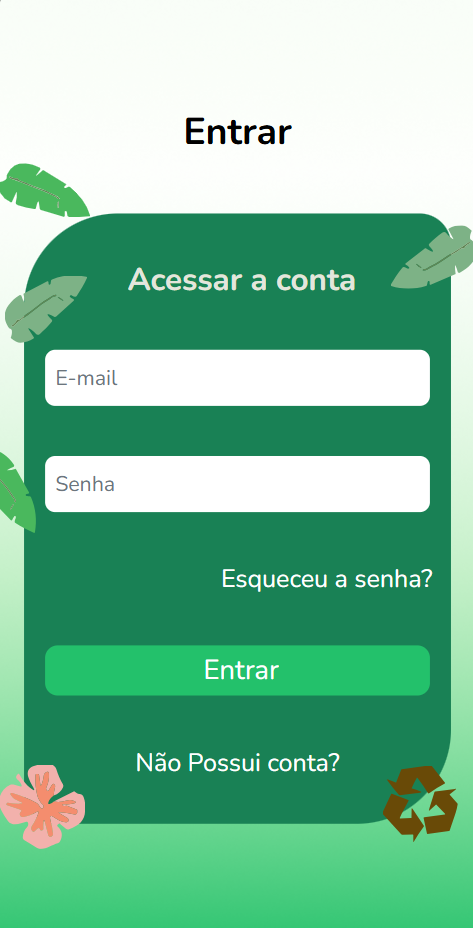 Login |
| 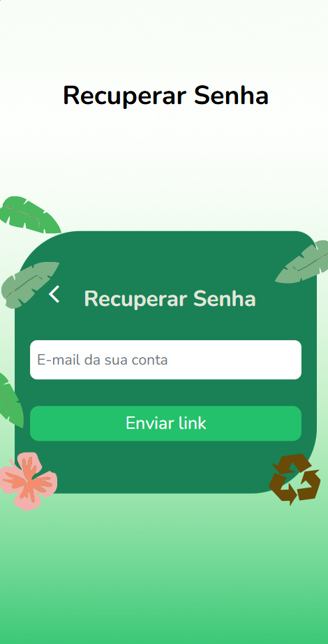 Recuperar senha: e-mail | 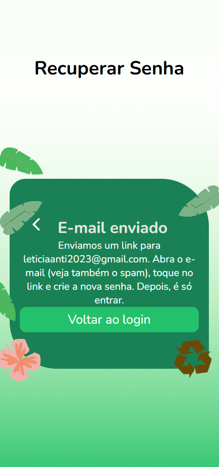 Recuperar senha: e-mail enviado | |

## 2. Início e jornada

Na tela inicial fica a sua árvore, que muda a cada nível concluído e vira dourada ao fim do nível bônus. Toque em **Continuar** para escolher o nível e a fase. Cada fase começa com uma narrativa e segue para o quiz: errar custa uma folha de vida (e a alternativa fica vermelha); acertar deixa a alternativa verde, mostra o "Você sabia?" e libera o botão **Continuar**. Ao concluir um nível, aparece a tela **Fim do nível**.

| | | |
|---|---|---|
| 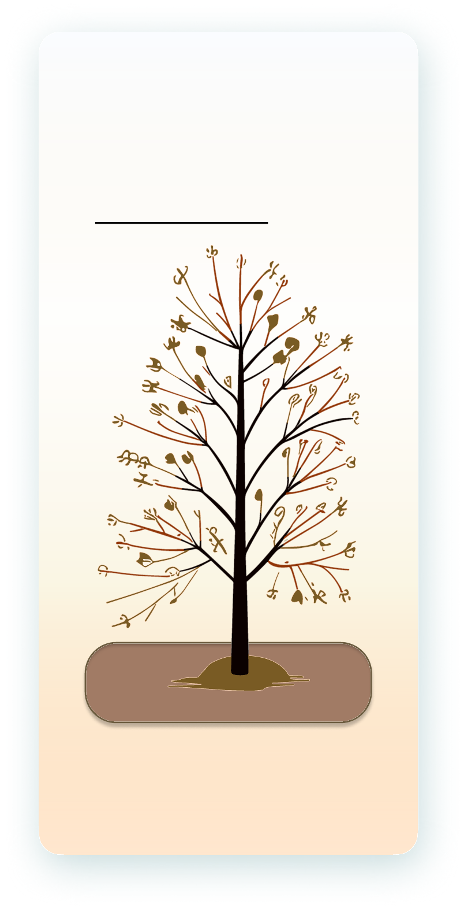 Início: árvore seca | 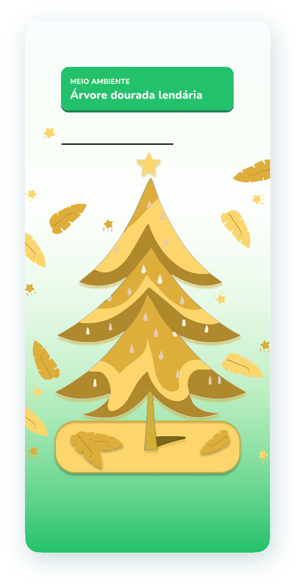 Início: árvore dourada | 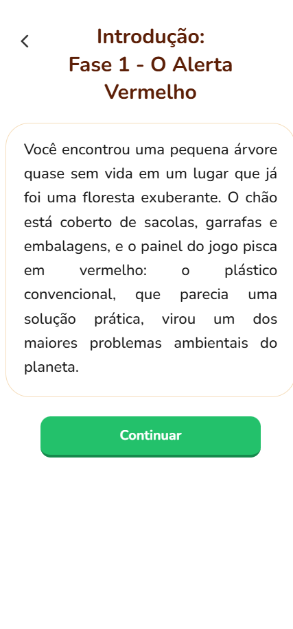 Narrativa da fase 1 |
| 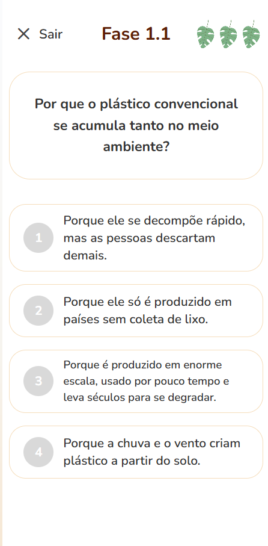 Quiz: pergunta | 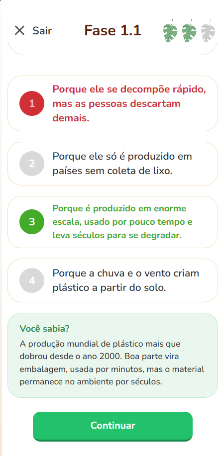 Quiz: resposta correta e "Você sabia?" | 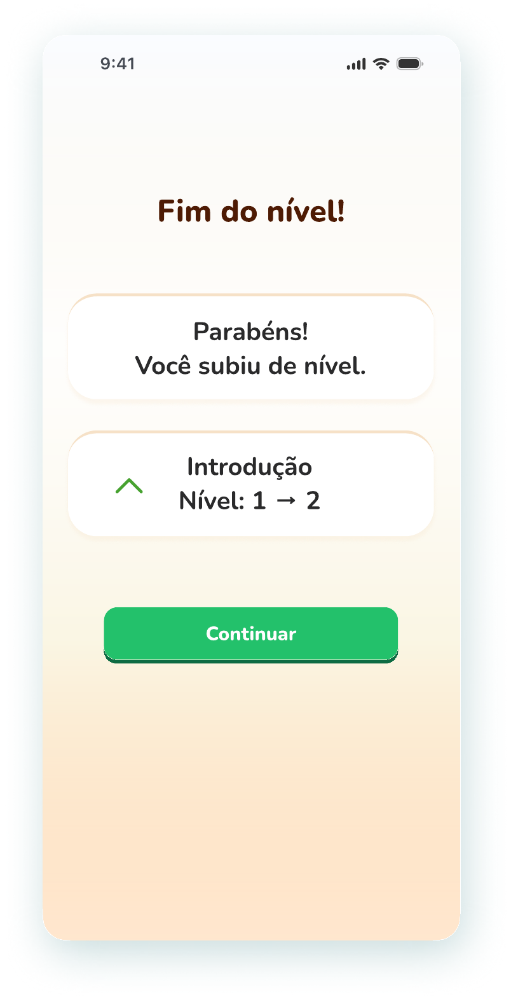 Fim do nível |

## 3. Suas árvores, ranking e amigos

**Suas árvores** mostra as árvores de cada etapa (bloqueadas até você chegar lá). **Ranking** compara você e seus amigos por nível e pontos. Em **Amigos**, a árvore mostra seus amigos; toque em **Gerenciar amizades** para adicionar (pelo e-mail da conta), favoritar (estrela) ou remover (lixeira). Use a seta de voltar, ou a aba Amigos, para voltar à árvore.

| | | |
|---|---|---|
| 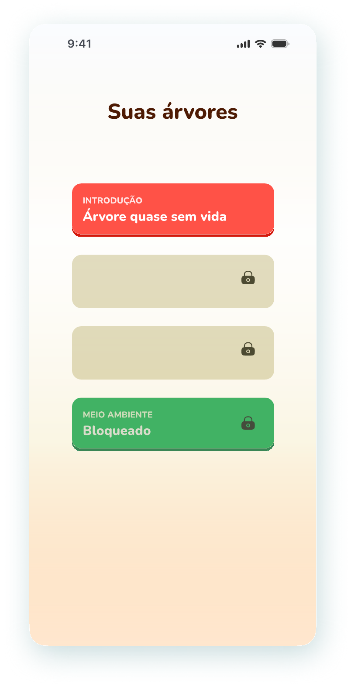 Suas árvores | 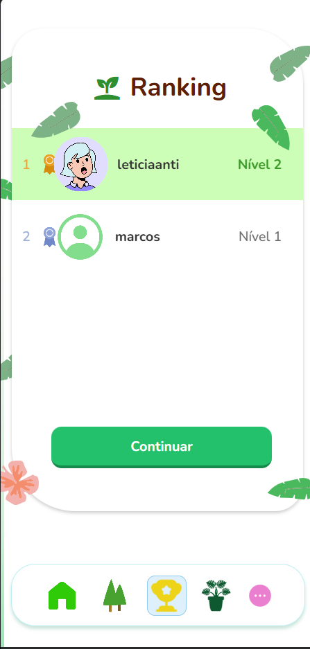 Ranking | 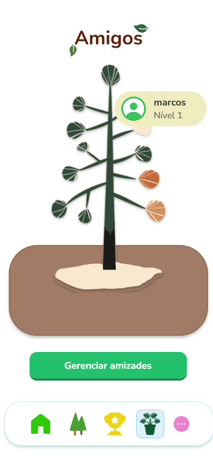 Amigos: árvore |
| 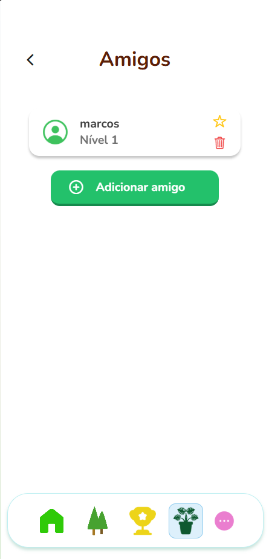 Amigos: lista | | |

## 4. Conta, configurações e privacidade

Pelo botão **...** da barra inferior você acessa **Conta** (alterar nome, alterar senha, receber link de redefinição por e-mail e sair), **Configurações** (alertas e notificações, com vibração ao errar uma resposta; e suporte com e-mail e telefone de contato) e **Privacidade**. Em **Privacidade**, a opção **Apagar meus dados** faz um reset: apaga o seu progresso e a sua lista de amigos e você recomeça do nível 1. A sua conta e o seu login continuam, e os seus amigos continuam vendo você (no nível 1). Não é possível desfazer.

| | | |
|---|---|---|
| 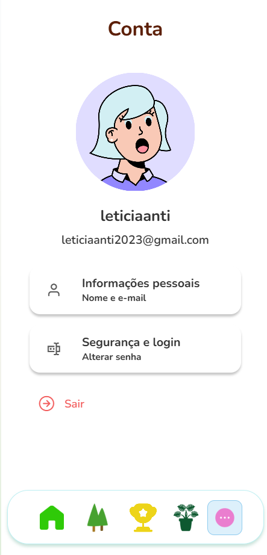 Conta | 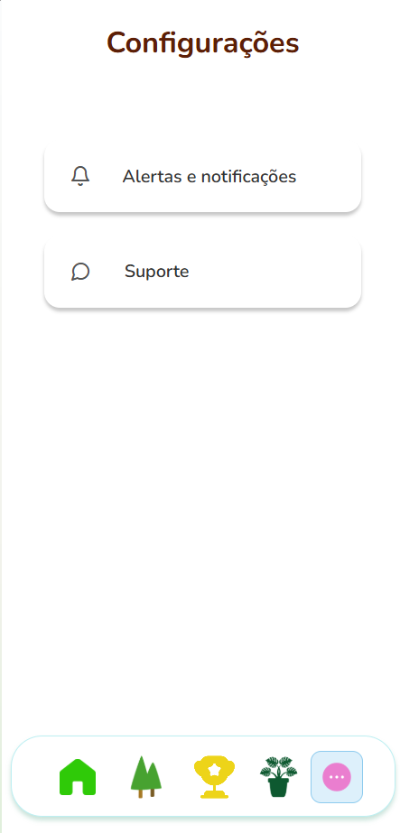 Configurações | 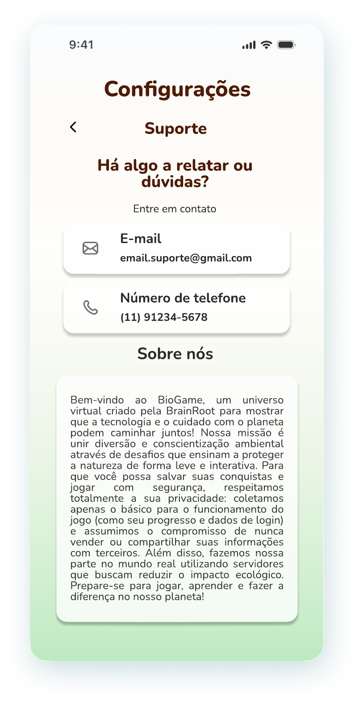 Suporte |
| 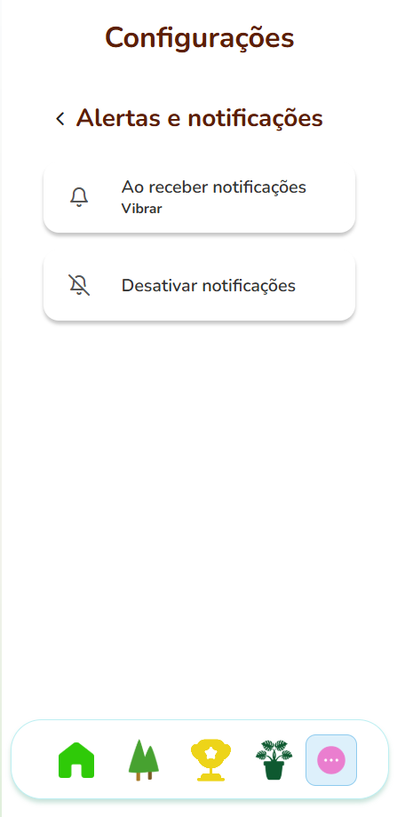 Alertas e notificações | 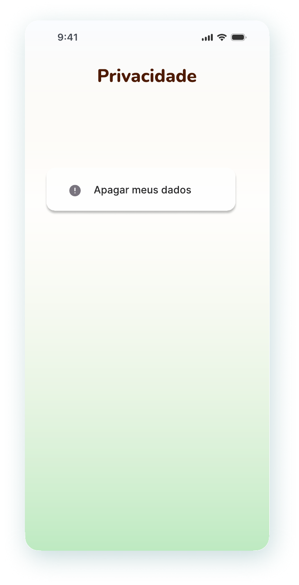 Privacidade | 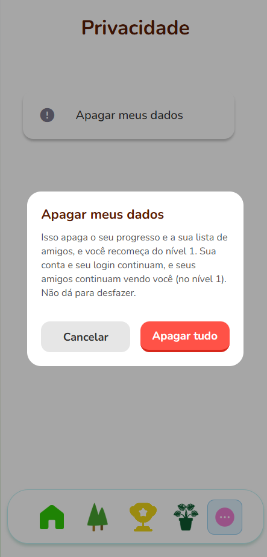 Apagar meus dados |
| 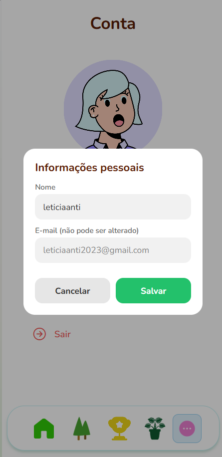 Informações pessoais | 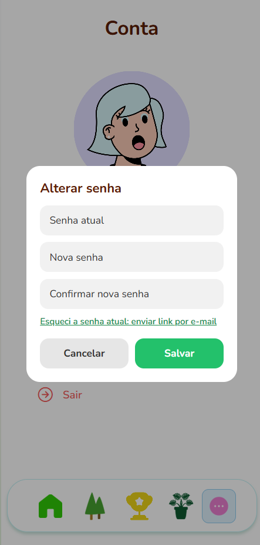 Alterar senha | |
